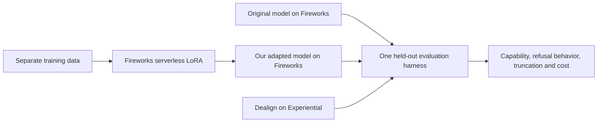

# FireworksHack

A reproducible comparison of the original DeepSeek V4.1 Flash 1017, a LoRA trained with Fireworks Serverless Training, and Dealign's released modification served through Experiential.

**Status: plan only. No training or evaluation results yet.**

The experiment asks whether a small training intervention can change refusal behavior while retaining capability. Benign helpfulness, harmful compliance, and general capability are reported separately. A tiny pilot establishes that the workflow runs; it cannot establish that a model outperforms Dealign.

- [Experiment design and evidence](docs/experiment-design.md)
- [Implementation plan](docs/superpowers/plans/2026-11-02-deepseek-comparison.md)
- [Continuation checklist](HANDOFF.md)

The controller runs on a CPU VM; model training and inference run on providers. No local GPU or download of the full checkpoint is required for this design. Actual account access, training capacity and endpoint behavior still require verification.

The first proposed dataset is a reviewed benign-response subset of WildGuardTrain. It is an overrefusal pilot, not Dealign's unpublished calibration data. See the design for access requirements, limitations and alternatives.

Runtime secrets, datasets, checkpoints and raw responses stay outside Git. `.env.example` contains variable names only. Third-party datasets and models retain their own licenses and access conditions.
