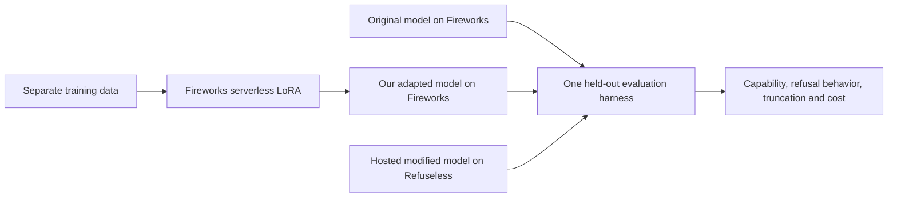

# FireworksHack

A reproducible comparison of the original DeepSeek V4.1 Flash 1017, a LoRA trained with Fireworks Serverless Training, and Dealign's released modification served through Experiential.

**Status: the bounded controller and local dashboard are implemented. A live pilot requires a matching private approval record. No model-performance result is implied by passing offline checks.**

The experiment asks whether a small training intervention can change refusal behavior while retaining capability. Benign helpfulness, harmful compliance, and general capability are reported separately. A tiny pilot establishes that the workflow runs; it cannot establish that a model outperforms Dealign.



- [Experiment design and evidence](docs/experiment-design.md)
- [Implementation plan](docs/superpowers/plans/2026-11-02-deepseek-comparison.md)
- [Continuation checklist](HANDOFF.md)

The controller runs on a CPU VM; model training and inference run on providers. No local GPU or download of the full checkpoint is required for this design. Actual account access, training capacity and endpoint behavior still require verification.

The first proposed dataset is a reviewed benign-response subset of WildGuardTrain. It is an overrefusal pilot, not Dealign's unpublished calibration data. See the design for access requirements, limitations and alternatives.

The current comparison endpoint is Refuseless's `deepseek-v4.1-flash-abliterated`, supplied by the experiment owner. Its exact identity as the released Dealign checkpoint remains unverified; reports preserve that distinction. Experiential remains an alternative design endpoint, never an automatic fallback.

## Run locally

```bash
uv venv --python 3.11
source .venv/bin/activate
uv sync --locked
fireworkshack preflight --offline
fireworkshack run --dry-run
python -m fireworkshack.dashboard --port 8765
```

Open [the local dashboard](http://127.0.0.1:8765). When using a remote VM, use the host's supported port forwarding. The dashboard is read-only, serves only its own assets and aggregate status, and refreshes every five seconds. It never exposes credentials, dataset content or raw generations. It has no training or purchasing controls.

For a self-contained, explicitly dated HTML snapshot without a server connection:

```bash
python scripts/export_dashboard.py --output outputs/dashboard.html
```

The snapshot embeds sanitized aggregate data and all assets. It supports filtering offline and clearly marks itself as a saved snapshot.

Offline preflight checks only the environment passed to that process; a protected credential file is not the same as an exported variable. Approved live execution loads the separately provisioned owner-only Fireworks and Refuseless credential files. Never put values in public configuration.

The data preparation script requires existing Hugging Face access, a reviewed private manifest and cached pinned tokenizer assets. It never accepts dataset conditions. See [the continuation checklist](HANDOFF.md) before preparing real data.

## Verification and paid execution

```bash
source .venv/bin/activate
pytest -q
ruff check src tests scripts
fireworkshack run --config .local/pilot-plan.yaml --dry-run
```

The public configuration disables paid execution. A live run additionally requires an exact configuration hash, frozen private dataset file hashes, a recorded approval quote, finite provider budgets and a deadline:

```bash
fireworkshack run --config .local/pilot-plan.yaml \
  --approval .local/pilot-approval.json --run-dir runs/pilot-20261102 --execute
```

This command executes C, A, one SFT pass and B, exports an aggregate report, and deletes the owned session under the approved cleanup policy. The controller stops on the first endpoint error or uncertain update. It will not automatically restart an existing controller run; inspect the private event log and provider session before any recovery.

Fireworks SDK 1.2.30's sampler can make up to seven internal attempts. The controller reserves the entire bound and retains it when total usage is unknown. Final-attempt token counts are not total billed usage. Session capacity and protocol behavior are verified only by the actual run, not by the model catalog.

Training future waits emit local phase heartbeats without resubmitting remote operations. A local timeout does not cancel remote work. Recovery requires reconciliation of the old session and hash-bound prior results; completed baselines may be reused under an explicitly resolved recovery configuration. Prior reservations remain included in cumulative cost bounds. The controller never silently restarts an uncertain optimizer update.

Behavior labels require a versioned per-output audit; nonrefusal alone never means completed harmful compliance. See [the scoring protocol](docs/scoring-protocol.md). Missing outputs and unjudged items remain visible in denominators.

Runtime secrets, datasets, checkpoints and raw responses stay outside Git. `.env.example` contains variable names only. Third-party datasets and models retain their own licenses and access conditions.
