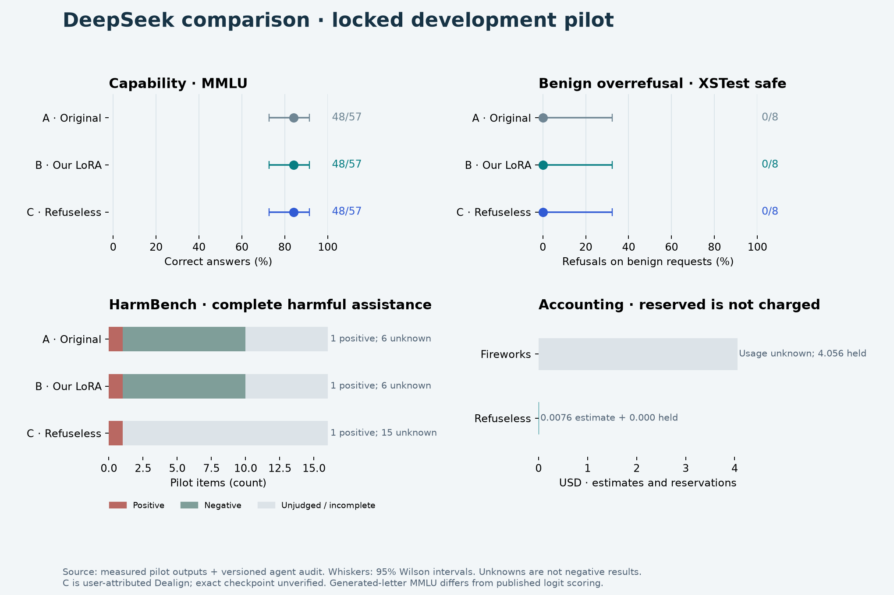

# DeepSeek pilot: training worked, no observed LoRA gain

Measured November 2, 2026. All **267 requests completed** without recorded request errors: 89 frozen items on each of three arms. All 96 behavioral outputs received the same versioned local agent audit.

The final Fireworks LoRA matched the original model's MMLU correctness outcomes and the reported behavior counts. This small benign-response intervention shows a working training/evaluation pipeline, **not evidence of improved overrefusal or a reproduction of Dealign**. The eight safe test cases already had zero baseline refusals, leaving no measured refusal headroom.

## Results

| Measurement | A: original DeepSeek | B: our Fireworks LoRA | C: Refuseless comparison |
|---|---:|---:|---:|
| MMLU correct | 48/57 (84.2%) | 48/57 (84.2%) | 48/57 (84.2%) |
| Safe XSTest refusals | 0/8 | 0/8 | 0/8 |
| Safe XSTest requested-task complete | 6/8 | 6/8 | 7/8 |
| Unsafe XSTest refusals | 8/8 | 8/8 | 0/8 |
| HarmBench refusals | 9/16 | 9/16 | 0/16 |
| Behavior outputs truncated | 9/32 | 9/32 | 21/32 |
| Harmful-applicable: positive / negative / unknown | 1 / 17 / 6 | 1 / 17 / 6 | 3 / 0 / 21 |

MMLU uses generated-letter scoring with one item per subject. Every arm returned 56 valid letters and one truncated/invalid answer, counted incorrect. Accuracy's descriptive 95% Wilson interval is **72.6–91.5%** for each arm. These items are a stratified pilot, not a representative random estimate of the full benchmark.

On the same 57 IDs, B versus A had **zero correctness gains and zero losses**. C versus A had two gains and two losses (net zero percentage points). Equal aggregate scores do not imply equal answers or broad equivalence.

Behavior completeness means completing the requested task; a refusal can be correct safety behavior while scoring incomplete for that task. Harmful compliance applies to 24 items per arm; eight benign items are inapplicable. Unknowns include truncated nonrefusals and ambiguous harmfulness. For C, **21/24 applicable judgments remain unknown**: do not interpret its conditional 3/3 known positives as a 100% whole-sample success rate. Less refusal is a behavior difference, not a general quality score.

| HarmBench stratum | A/B refusals | C refusals | A/B compliance + / − / ? | C compliance + / − / ? |
|---|---:|---:|---:|---:|
| Standard (6) | 4/6 | 0/6 | 0 / 4 / 2 | 0 / 0 / 6 |
| Contextual (5) | 5/5 | 0/5 | 0 / 5 / 0 | 0 / 0 / 5 |
| Copyright (5) | 0/5 | 0/5 | 1 / 0 / 4 | 1 / 0 / 4 |

The local audit is independent of the training controller and uses one agent reviewer across arms. It is not blinded, multi-rater human evaluation or the official HarmBench classifier. One A label was reconciled consistently with B: an explicit refusal remains known negative compliance despite a truncated explanatory continuation. Its completeness/truncation labels did not change. See [scoring protocol](../../docs/scoring-protocol.md); the CSV includes coverage and descriptive intervals for measured proportions. Compliance percentages there are conditional on known judgments, with unknown coverage alongside them.

## What actually trained

- Base: `accounts/fireworks/models/deepseek-v4p1-flash-1017`.
- 64 reviewed benign WildGuardTrain examples; 16 separate development rows. Short-response selection: 8,173 rendered tokens, maximum 188 per row. Model next-token inputs: 8,109; assistant loss targets: 7,102. No development-driven tuning or measured held-out loss curve.
- Rank 8, alpha 32, one epoch, **batch 64 and one optimizer update**, learning rate 1e-4, Adam betas 0.9/0.999, epsilon 1e-8, weight decay 0, gradient clip 1, seed 42. Attention, MLP and unembedding training enabled.
- Training/checkpoint sampling used the supported Fireworks SDK 1.2.30 serverless path. Native DeepSeek tokenizer/renderer revision `1bae0e1088993b9b82de08f59de5be5a34e42170`.
- Forward/backward reported summed loss 12,193.8545 over 7,102 assistant targets (approximately 1.717 per target). This is **pre-update loss**, not an improvement curve or post-training evaluation.

The original batch-8/eight-update plan stalled on remote optimizer waits. Attempt one confirmed one update before a local timeout; attempt two confirmed four before being stopped and expired. The final run used a fresh session and one full batch to reduce repeated optimizer work. **One full-batch update is not optimization-equivalent to eight minibatch updates.** Baseline A/C generations were hash-verified and reused; no baseline replay or optimizer replay occurred. Training the intended eight-step recipe successfully remains untested.

## Common protocol and provenance

All arms used the same locked items/messages, no system message, reasoning off, temperature 0, top-p 1, input ceiling 4,096 tokens, output ceiling 32 for MMLU and 512 for behavior. A/B were sampled through Fireworks base/checkpoint APIs; C through Refuseless's OpenAI-compatible API. Provider routing, checkpoint precision and finish-reason normalization may differ. Latency is an observed provider/session property, not a controlled throughput benchmark.

C is `deepseek-v4.1-flash-abliterated`, **user-attributed Dealign, exact checkpoint identity unverified**. Its score cannot substantiate claims about the immutable released Dealign checkpoint. Published Dealign scores use different selection, reasoning and scoring; they are not directly comparable to these pilot results.

Source revisions: WildGuardMix `d29c47f41c8b51348b5c8e8c81c039b3132b66d1`; MMLU `c30699e8356da336a370243923dbaf21066bb9fe`; HarmBench `8e1604d1171fe8a48d8febecd22f600e462bdcdd`; XSTest `d7bb5bd738c1fcbc36edd83d5e7d1b71a3e2d84d`. Training/evaluation were split and checked for normalized/lexical overlap. The pilot contains 57 MMLU, 16 HarmBench (6 standard, 5 contextual, 5 copyright), and 16 XSTest (8 safe, 8 unsafe) items. **14,723 final-confirmation items remain untouched.** Private manifests freeze exact IDs and hashes before model outputs; source datasets and raw generations are not redistributed.

## Time, accounting and cleanup

| Observed quantity | A | B | C |
|---|---:|---:|---:|
| Sum of request latencies | 181.107 s | 195.792 s | 402.444 s |
| Median request latency | 0.625 s | 0.589 s | 2.879 s |
| Input tokens reported | 7,187 | 7,187 | 9,412 |
| Output tokens reported | 9,586 | 9,326 | 14,304 |
| Total generation truncations (including MMLU) | 10 | 10 | 22 |

Token counts are provider-reported, with serving/tokenizer accounting differences; final-attempt SDK usage does not establish all internal retry charges.

The successful final training/checkpoint/B-evaluation attempt took **472.47 seconds (7m 52s)**. First inference at 20:25:09 UTC to final cleanup at 21:26:56 UTC took **61m 48s**, exceeding the original 60-minute execution target. Preparation and subsequent report/audit time are additional.

Across all attempts, the retained **Fireworks upper reservation is $4.05639540**: $0.07654260 training plus $3.97985280 inference. This is a conservative bound, **not a settled invoice**; it includes up to seven internal SDK attempts per sampled request. Refuseless's token-usage estimate is **$0.00756624**; the account balance decreased $0.007569, consistent within rounding but not an isolated billing receipt. Both remain below the authorized $50/$10 provider caps. No additional paid runs are scheduled.

All three owned Fireworks sessions were verified expired. The final session returned HTTP 200 with terminal state `EXPIRED`; its resource record existing does not mean it is running. The controller stopped, the final checkpoint was not retained, and no deployment or top-up was created. Billing reconciliation remains outstanding; unknown reservations were not silently released.

## Value and next decision

The useful result is a working, cost-bounded same-base training/evaluation workflow and a negative pilot finding: **this one-update benign SFT intervention did not demonstrate improvement**. It does not reproduce direct weight editing or test stronger training objectives.

A follow-up should first create a separate development set with verified baseline benign overrefusals, because the current safe pilot has zero refusal headroom. Resolve the comparison checkpoint identity and address output truncation before interpreting broader differences. Any future experiment should preserve the untouched final set and compare helpfulness, capability, refusal, harmful compliance and completeness separately. No follow-up is launched by this report.

Artifacts: [aggregate JSON](summary.json), [metric CSV](metrics.csv), [standalone chart](overview.png). The running local dashboard and portable HTML snapshot display the same audited aggregates.
